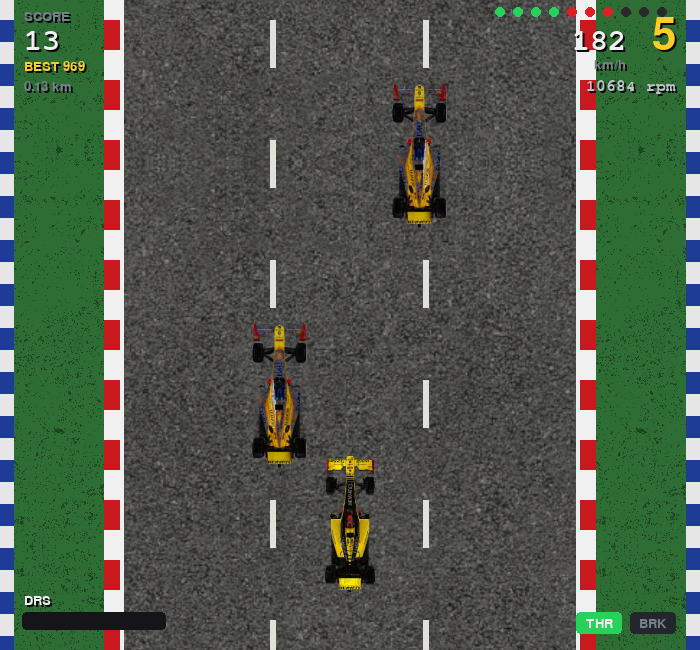

# F1 Race Road

A top-down endless racer written in Python with pygame.



## How it works

Speeds and distances are modelled in real units (km/h, m/s, metres) and only converted to pixels when the frame is drawn.

- **You drive the throttle and the brake.** The car's speed comes out of a force balance, `m·dv/dt = F_drive − F_drag − F_roll − F_brake`, with real F1-like numbers: 798 kg, 740 kW, and aerodynamic drag `½·ρ·CdA·v²`.
- **Power and grip limits:** at low speed the tyres limit acceleration (about 1.1 g); at high speed the engine's power does. That gives 0–100 km/h in 2.6 s, 0–200 in 5.7 s, 0–300 in 10.3 s, and a top speed of about 356 km/h.
- **Lifting off and braking:** without throttle the car coasts down under drag and engine braking. The brakes give about 2.9 g, so from top speed to a stop takes about 3 seconds.
- **DRS:** every clean overtake fills the DRS meter. Opening DRS lowers the drag (CdA 1.25 → 1.02 m²), which raises the top speed to about 381 km/h for 4 seconds.
- **Grass:** off the track the tyres put down only 30% of the traction and the car meets extra resistance, so it slows to about 100 km/h even at full throttle.
- **Lateral model:** steering is a force against damping (`m·x'' = F_steer − c·x'`), so the car drifts into a lane instead of snapping to it.
- **Scale:** the car sprite is about 5.6 m long. The sideways axis uses about 25 px/m, while the scrolling axis is compressed to 10 px/m so that 300 km/h is still playable.
- **Traffic:** backmarkers spawn in rows that always leave a gap you can drive through, and get denser the longer you survive.

## Running it

```
pip install pygame
python F1Race.py
```

## Controls

| Action | Keys |
|---|---|
| Throttle | W or ↑ |
| Brake | S or ↓ |
| Steer | A / D or ← / → |
| Open DRS (when the meter is full) | Shift |
| Pause | Space / P |
| Back / quit | Esc |

The high score is saved in `textfile/high_score.txt`.
